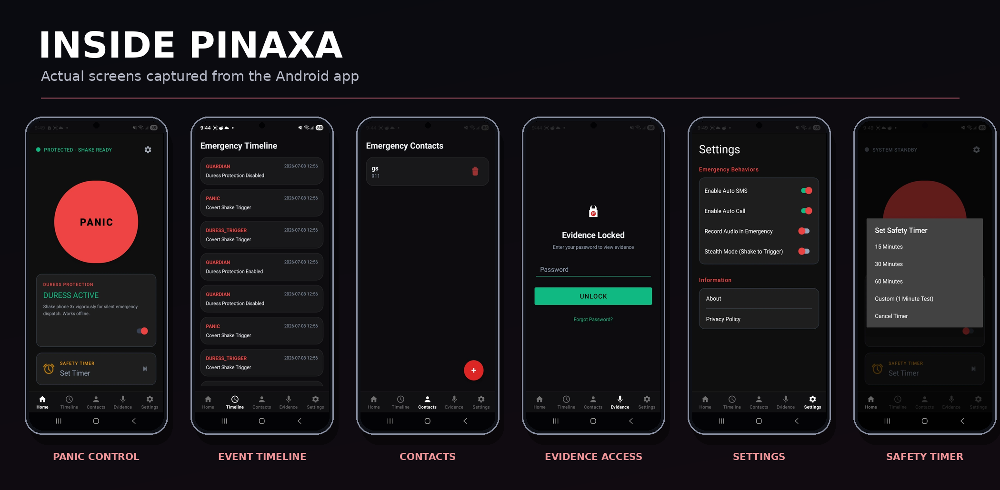

# PINAXA · The story before the simplified safety app

**From a multi-module Android guardian to a focused personal safety product.**

[← Return to the current PINAXA showcase](README.md) · [Meet the developer](https://github.com/geda21)

---

## The original vision was much bigger

Before the present PINAXA interface, I built and rebuilt an ambitious **Android guardian** combining a camera interface, voice interaction, expressive assistant faces, emergency workflows, logs, and experiments with on-device model integration.

This was not just a diagram or prompt. I created Android projects and APKs, worked on CameraX/ML Kit integration, built Java components, debugged Gradle and manifest errors, and tested functioning interfaces on my phone. Some older project revisions and the original local model files are no longer available.

**Why keep this history?** Because the final version does not show the technical experiments that led to it.

## May 2026 · Real builds, real debugging

In May, I was experimenting with camera and voice processing inside Android projects.

- **May 19:** Build logs captured missing ML Kit classes in `CameraHelper.java`. I was troubleshooting the toolchain directly from the phone.
- **May 25:** Prototype screens show an offline-labelled guardian, camera preview, bounding-box overlays and diagnostic event logs. A log explicitly labels a `weapon_knife_mock` trigger as simulated.
- **May 26–27:** Animated blue-eye and purple-eye robot concepts with character states, listening, emergency activation and command history. A later build log shows a failed `downloadThreatModel` task.
- **May 30:** Another guardian face with yellow attention eyes, ready/listening status and camera-related status text.

The interface and behavior evolved repeatedly. The surviving screenshots document what the device displayed. They do not independently establish model accuracy, autonomous threat assessment, or reliable real-world emergency dispatch.

## Eight visual experiments from the guardian years

This illustration compares eight separate visual states: **cyan scanner eyes, minimal purple face, friendly blue eyes, intense blue eyes, emergency activation, safety confirmation, yellow attention and yellow listening**. The **original Android screenshots are now uploaded** and displayed in the [developer's actual PINAXA evolution gallery](https://github.com/geda21/geda21#pinaxa-guardian--eight-actual-robot-versions). The graphic is an editorial redraw, not a fabricated application screenshot.

## I wanted PINAXA to have a face

I tried several visual identities: soft blue eyes, a minimal purple-square face, larger animated eyes, yellow attention states, and a character responding to emergency commands.

These experiments were my way of exploring whether an assistant could communicate urgency, reassurance and state changes **without relying on dense technical text**.

## The larger guardian architecture

The original specification envisioned:

| Module | Intended responsibilities |
|---|---|
| **Vision** | Camera processing, face/object overlays, potential-threat classification |
| **Voice** | Command recognition, replies, safety check-ins |
| **Decision logic** | Interpret signals and choose a response |
| **Robot interface** | Visible moods, listening and warning states |
| **Emergency workflows** | SOS controls, contacts, alerts, recording and events |
| **Offline-first operation** | Local device behavior where supported |

The preserved Java archives contain working Android components, plus test/simulation paths and incomplete model files. Earlier local models were removed from some later copies. My account of earlier successful on-device tests is part of the project history; the currently preserved archives alone cannot verify every original model or test outcome.

## The important decision: reduce scope

After repeatedly building the broader PINAXA Guardian concept, I changed its direction.

The present **PINAXA v2.0** emphasizes deliberate emergency interaction: a large PANIC button, configurable shake/duress mode, emergency contacts, event history, safety timers and a password gate for evidence.

The redesign was not the absence of ambition. It was a choice to prioritize fewer, understandable features with a more realistic path to reliability.

**I learned that solving a hard problem sometimes means removing features, not adding them.**

## What this project proves

It shows practical Android development: writing and debugging native code, integrating camera/voice components, prototyping stateful interfaces, facing build failures, maintaining successive versions and redesigning based on usability.

It does **not** claim certified emergency performance, validated offline threat detection or guaranteed SMS/call delivery. Safety-critical systems require much more testing before anyone should rely on them.

---

**Geda Taye** · Self-taught Android & Web Developer · Ethiopia

[Current PINAXA](README.md) · [NONOX on Google Play](https://play.google.com/store/apps/details?id=com.nonox.app) · [GitHub profile](https://github.com/geda21)
