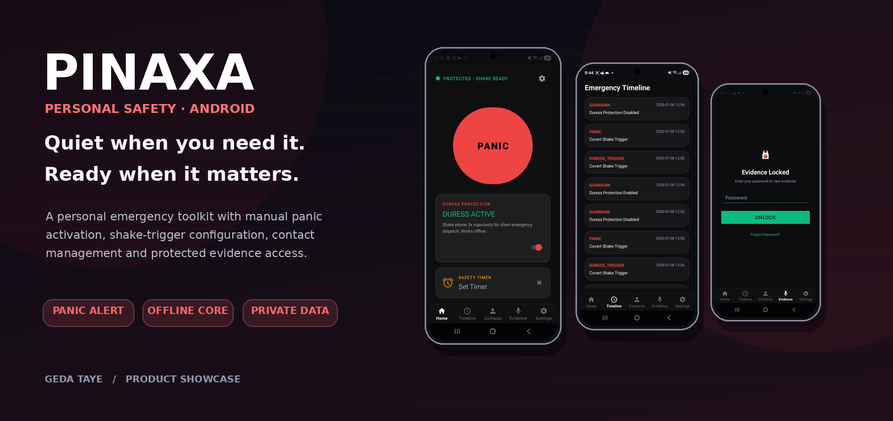

# PINAXA Guardian — How I built it, broke it, rebuilt it, and changed direction

**A real development story by Geda Taye · Ethiopia · 2026**

[← Current PINAXA safety app](README.md) · [My complete developer story](https://github.com/geda21) · [All original screenshots](https://github.com/geda21/geda21/tree/main/robot-evolution)

---

## The PINAXA you see today wasn't the first PINAXA.

When people open my current PINAXA showcase, they see a large red panic button, a contact list, an emergency history, an evidence screen and a timer.

But that's not where the project started.

I originally wanted something much bigger: **a guardian that could look through the phone camera, listen to commands, change its expression and respond during an emergency**. I tried to make that idea work directly on my Android phone, without a laptop or a separate team.

I created multiple Java Android projects, compiled APKs and rebuilt the interface many times. Some of those versions are gone now. The screenshots and source archives I kept show how the idea changed.

## May 19 — A build that would not compile

In one screenshot from my mobile development environment, `CameraHelper.java` fails because the ML Kit face detection classes cannot be resolved. Other captured builds show missing Android resource styles, dependency problems and a model-download task that fails.

I was working on camera and voice behavior. But before I could test the result, I first had to get the Android build environment to agree with my code.

That is an important part of the story. I was learning Android by encountering its real constraints: dependencies, permissions, manifests, resource linking and the differences between code that looks valid and code that can actually compile.

**A red error log was not the end of the project. It was usually the beginning of another attempt.**

## May 25 — The first guardian on the screen

I eventually had versions displaying a camera image, bounding-box overlays, status information, an SOS button and a scrolling log.

The interface shows labels, coordinates/boxes and a `weapon_knife_mock` alert entry. That entry is **explicitly a simulated trigger**. The screenshot is useful evidence of the camera interface and event-handling experiment, but it is not evidence of a validated real-world weapon detector.

Another early version used a different layout, with the camera view above a guardian control and large emergency actions:

I wasn't building one static design. I was rebuilding how the app should behave and what the user should see.

## May 25–30 — Eight experiments with one question: how should the guardian react?

I wanted PINAXA to feel like a presence, not a lifeless button.

First I tried glowing cyan eyes. Then a small purple face. Then friendly blue eyes. Then a more intense expression. I designed screens for an activated emergency, a check-in where the app waited for the person to say they were safe, and finally yellow attention/listening states.

These are **eight original Android screenshots** from my experiments, not new promotional illustrations:

<table><tr><td width="25%" align="center"> Glowing cyan scanner eyes</td><td width="25%" align="center"> Purple minimal expression</td><td width="25%" align="center"> Friendly blue-eyed guardian</td><td width="25%" align="center"> Sharper blue-eyed expression</td></tr>
<tr><td width="25%" align="center"> Emergency activated state</td><td width="25%" align="center"> Safety check-in message</td><td width="25%" align="center"> Yellow-eyed attention</td><td width="25%" align="center"> Listening and status</td></tr></table>

The difference between the faces mattered to me:

- The **cyan and purple** versions explored whether a simple abstract face could communicate that the app was present.
- The **blue-eyed** versions explored how a change in expression could convey a different state.
- The **emergency** version displayed an activation message after a help command.
- The **safety check-in** version displayed a request for the user to confirm they were okay.
- The **yellow-eyed** versions displayed attention, listening and guardian status.

These experiments were part of the same project journey, not separate products. The interaction screens show responses that appeared during testing; they don't establish reliability in every emergency.

## The models and builds I no longer have

I experimented with ML Kit, TensorFlow Lite files and offline-focused processing. I remember earlier local AI functionality working during development. Over time I deleted some model assets and several old versions disappeared from my phone.

The surviving source archives still show Android activities, camera and voice integration attempts, services, security flows and stateful interfaces. They also include mock detection paths and incomplete model assets in some revisions.

I'm keeping that distinction clear: **the surviving evidence documents substantial implementation and experimentation, but it cannot independently verify every model that once existed or every test I remember.**

## Why I stopped adding features

At a certain point, I had to ask a question that was more important than making the app intelligent:

**Would someone under pressure be able to understand it and trust it to do what it says?**

That changed the direction of PINAXA.

Instead of making the guardian do everything, I concentrated on a smaller set of deliberate functions: a prominent panic control, configurable shake/duress mode, emergency contacts, safety timers, an event timeline and password-protected evidence access.

The present PINAXA is the simpler product. The old version was an ambitious working development project with multiple experimental subsystems. I built and tested versions of that larger idea before deciding which parts belonged in the product I wanted to maintain.

**Simplifying it wasn't forgetting the earlier work. It was learning from that work.**

## What this experience taught me

I learned to fight build errors rather than avoid them. I learned how complicated camera, voice and Android service behavior can become. I learned why a screen saying “SAFE” or “DANGER” is not enough to establish actual detection accuracy. And I learned that designing for emergencies requires more discipline than adding more AI features.

I still have source ZIPs, screenshots and the later safety app to show for it.

That's why I include the incomplete experiments in my portfolio. **They demonstrate the work behind the finished screens.**

---

**Safety and evidence note:** Early PINAXA alerts included simulated detections, and the surviving archives do not prove certified threat recognition or guaranteed SOS delivery. Safety functions need independent real-world validation; this page is an engineering-history account, not an emergency-service guarantee.

[Current product](README.md) · [Developer portfolio](https://github.com/geda21) · [Original screenshots](https://github.com/geda21/geda21/tree/main/robot-evolution)
